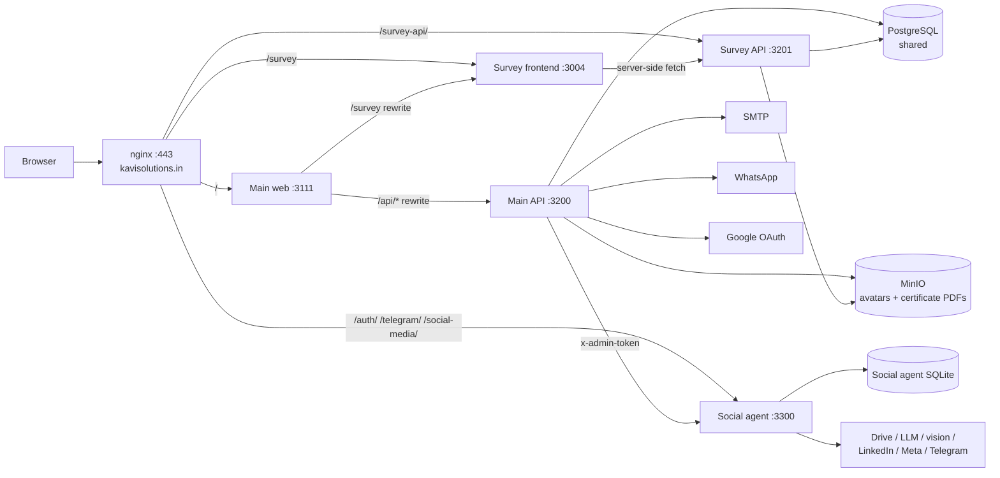

# Kavi Solutions — System Overview (Human Readable)

**Audience:** founders, team members, new developers, anyone who needs to know "what exists and how it fits together".
**Companion:** [`SYSTEM-OVERVIEW-AI.md`](SYSTEM-OVERVIEW-AI.md) — same system, written as dense context for AI assistants.

Last reviewed: 2026-11-26. Source of truth: code, `README.md`, `OPS-RUNBOOK.md`, and the linked docs in each section.

---

## 0. How to read this document

Terms used throughout:

| Term | Meaning here |
|---|---|
| **Service** | A separately deployed/running process with its own port and lifecycle. It may share code or database with another service. |
| **App / page** | A user-facing route inside a service. Not a separate deployment. |
| **Module** | A backend feature area (controller + service + DB tables) inside the NestJS API. |
| **Future / proposed** | Designed or documented but **not built**. Never counted as a service today. |

We keep these separate on purpose: a page like `/farms` is a feature of the main site, not its own service; `Survey` **is** a separate service because it has its own frontend deployment and its own API process.

---

## 1. Main Kavi Solutions site

**Service:** `kavi-solutions` (Next.js 16) — public marketing site, member workspace, and the browser entry point for the admin panel. Runs on port **3111** in production. Code: `app/`.

### 1.1 Home and service pages

- `/` — homepage: hero, services, project showcase, emerging tech, fellowship, farms/civic sections, team, contact.
- `/web`, `/mobile`, `/product`, `/marketing`, `/ai-blockchain` — service detail pages driven by `app/lib/services-data.ts`.
- `/projects` — portfolio; built-in entries can be replaced by `GET /api/projects`.
- `/team` — team directory; built-in entries can be replaced by `GET /api/team`.

The site uses Tailwind CSS 4, Framer Motion, and Three.js for the fellowship orbit map and the scroll-driven story.

### 1.2 Other public pages

- `/fellowship` — 11-month fellowship programme (Three.js story).
- `/gurukulam` — proposed long-term learning/earning pathway. Interest form writes to the backend.
- `/verify` and `/verify/<id>` — certificate verification by ID; the second form is meant for printed QR codes.

### 1.3 Gated pages (admin-controlled)

These pages are hidden (404) until an administrator publishes them in **Admin → Settings → Live pages**. Publishing takes effect on the next request — no rebuild or redeploy.

- `/financial` — Financial Services.
- `/government` — Government Technology Services.
- `/farms` — Kavi Farms.
- `/survey` — Survey & Research, but this one is **proxied to a separate service** (see §3).

### 1.4 Fellowship public surface and private token links

- `/fellowship/guide` — printable guide, reads fellowship policy from the API.
- `/fellowship/status` — applicants check status.
- `/fellowship/support` — scholarship/equipment donation pledges.
- `/fellowship/offer/[token]`, `/fellowship/interview/[token]` — candidate-only links.
- `/mentor/portal/[token]`, `/mentor/interview/[token]`, `/mentor/review/[token]` — mentor-only portals and scorecards.
- `/alumni/update/[token]` — alumni self-update link.

These token links are issued from the admin panel; they are not public navigation.

### 1.5 Login and member workspace

- `/login` — email/password or Google sign-in. Sign-up is disabled; accounts are created by admins.
- `/dashboard` — overview, profile, certificates, workspace.
- `/profile` — edit own team profile and photo.

Authentication is **Better Auth** on the backend. The browser calls `/api/*` on its own origin; Next.js rewrites those calls to the backend, so the session cookie stays first-party.

---

## 2. Admin panel

All admin pages are inside the same main web service (`app/app/admin/`). The backend is the real gate: `AuthGuard` + admin-only decorators. The UI only reflects the server decision.

### 2.1 `/admin` — core console

Sections selected with `?section=`:

| Section | What it manages |
|---|---|
| `team` | Team members, photos, login creation, public team directory data |
| `roles` | Organisation role titles |
| `teams` | Teams/departments |
| `projects` | Featured projects and links shown on the public site |
| `certificates` | Issue, verify, revoke/reinstate, delete/restore, attach PDFs |
| `social` | Social-agent image calendar (import, captions, schedule, publish) |
| `admins` | Admin email allowlist (grant/revoke admin access) |
| `settings` | Company details, survey opportunities, **Live pages** switches |

Legacy `survey`, `surveyors`, and `enquiries` tabs now redirect to `/admin/survey`.

### 2.2 `/admin/leads` — unified lead inbox

Every public enquiry form (contact, survey, fellowship, financial, government, farms, Gurukulam) writes a `leads` row. This screen filters by service and status, searches, exports CSV, and lets staff update status and internal notes.

### 2.3 `/admin/fellowship` — admissions to alumni

Nine tabs: dashboard, applications, reviews, interviews, mentors, delivery, onboarding, alumni, cases. Handles cohort/policy terms, review scorecards and private tokens, interview scheduling and calendar files, mentor portals, verification checklists and documents, alumni outcomes, and POSH/safeguarding cases. Also contains WhatsApp connection settings and the audit trail.

### 2.4 `/admin/programme` — programme operations

Twelve tabs: overview, colleges, sessions, questions (field FAQs), content, inquiries (care queue), fees, stipends (including month 6–12 payroll generation), clients, placements, donations, Gurukulam. Most tabs are generic registers over `/api/fellowship-programme/admin/<resource>` endpoints.

### 2.5 `/admin/survey` — survey content and surveyors

Edits survey page content (brand, hero, services, network, approach, engagement), manages surveyors and their audit history, and reviews survey enquiries. This admin screen lives in the main app but manages data used by the separate Survey service.

---

## 3. Survey (Survey & Research)

### 3.1 What it is

A **separate frontend** (private git submodule `kavi-solutions/kavi-survey-research`, code in `survey/`) plus a **separate backend process**. It is published at `/survey` on the main domain.

- Frontend: Next.js 16, own deployment on port **3004**.
- Backend: the **same NestJS codebase** as the main API, started as a second PM2 process on port **3201**.
- Database: the **same PostgreSQL database** as the main API.

The two API processes do not depend on each other: restarting the main API does not take Survey down, and vice versa. The shared database is the remaining single point of failure.

### 3.2 Pages and editing

- `/survey` — public page with enquiry form and surveyor registration.
- `/survey/admin` — content editor and enquiry list; requires an admin session (checks `/api/me` through the survey API).

Content can also be edited from `/admin/survey` in the main app. Both paths write the same `survey_content` row through the API.

### 3.3 Connections

- Browser → nginx `/survey` → survey frontend `:3004`.
- Browser → nginx `/survey-api/` → survey API `:3201`.
- Survey frontend (server side) → `API_BASE_URL=http://127.0.0.1:3201`.
- Survey API → shared PostgreSQL + MinIO + SMTP, same as the main API.
- Survey API has `FELLOWSHIP_AUTOMATION_ENABLED=false` and `WHATSAPP_AUTOCONNECT=false`: only the main API runs the 06:00 daily reminder cron and the WhatsApp socket.

---

## 4. Other live surfaces (features, not services)

| Surface | Where it lives | Connects to |
|---|---|---|
| Financial Services `/financial` | Main site, gated | `POST /api/financial/enquiries` → `leads` + email |
| Government Technology `/government` | Main site, gated | `POST /api/government/enquiries` → `leads` + email |
| Kavi Farms `/farms` | Main site, gated | `POST /api/farms/enquiries` → `leads` + email |
| Gurukulam `/gurukulam` | Main site | `POST /api/fellowship-programme/public/gurukulam-interests` |
| Certificate verification `/verify` | Main site | `GET /api/certificates/<id>`, PDFs from private MinIO bucket |
| Social image calendar | Admin → Social | Main API proxy → social-agent sidecar |

None of these has its own process, port, or database today. Future separate domains for Financial, Government, and Farms are proposals only — see §7.

---

## 5. Separate services we have today

Count: **5 application services** (plus infrastructure dependencies). A "service" here means a separately deployed process with its own port and PM2 entry.

| # | Service | Tech / port | Code | Data | Why it is separate |
|---|---|---|---|---|---|
| 1 | Main web | Next.js 16, `:3111` | `app/` | None of its own | Serves public site + admin UI |
| 2 | Main API | NestJS, `:3200` | `api/` | Shared Postgres, MinIO | Owns auth, content, all core modules, cron, WhatsApp |
| 3 | Survey API | Same NestJS code, `:3201` | `api/` (2nd PM2 process) | Same Postgres, same MinIO | Isolates Survey uptime from main API restarts; automations disabled |
| 4 | Survey frontend | Next.js 16, `:3004` | `survey/` (git submodule) | No DB client | Separate deployment; can be released independently |
| 5 | Social agent | Fastify, `:3300` (localhost only) | `social-agent/` | **Own SQLite** DB | Optional sidecar for scheduled social posts; talks to external platforms |

### 5.1 Infrastructure dependencies

| Dependency | Role | Production location |
|---|---|---|
| PostgreSQL 16 | Single shared database for main + survey APIs | Container `kavi-pg`, `127.0.0.1:5436` |
| MinIO | Public avatars bucket + private certificate PDFs | Containers on `127.0.0.1:9002` / `:9003` |
| SMTP | Contact forms, password reset, survey and fellowship email | External provider (`SMTP_*` env) |
| Google OAuth | Optional sign-in with Google | External |
| WhatsApp (Baileys) | Fellowship messages; socket only on main API | External |
| Telegram, Google Drive, LinkedIn, Meta, Gemini/OpenAI/Groq/Cloudflare | Used by social-agent only | External |

### 5.2 What is **not** a separate service

- `/admin`, `/admin/leads`, `/admin/fellowship`, `/admin/programme`, `/admin/survey` — screens in the main web service.
- `/financial`, `/government`, `/farms`, `/gurukulam`, `/verify` — pages in the main web service.
- Fellowship, programme operations, certificates, leads, survey content — backend modules inside the main API (and the survey API process).
- Content engine and talent marketplace — documents only, not built.
- Separate domains for farms/financial/government/fellowship — proposals only.

---

## 6. Connections

### 6.1 Request flow

### 6.2 Connection rules worth remembering

1. **Browser never calls the backend origin directly.** It calls `/api/*` on the site origin; Next.js rewrites it to `:3200`. This keeps the auth cookie first-party.
2. **nginx does not proxy `/api`.** The Next.js rewrite does. `BACKEND_URL` must be set at build time and run time; production build fails if missing.
3. **Survey has two paths to the same data:** main app admin (`/admin/survey` → `:3200`) and survey frontend (`/survey/admin` → `:3201`). Same Postgres row.
4. **One writer for background jobs.** Only the `:3200` process runs the daily 06:00 fellowship automation and opens WhatsApp. Both APIs can run a manual automation request.
5. **Social agent is server-to-server only.** The browser talks to `/api/admin/social/*` on the main API; the API adds `x-admin-token` and proxies to `:3300`. nginx exposes only its OAuth callbacks, Telegram webhook, and public media.
6. **Admin rights come from the backend.** `user.role` containing `admin`, `ADMIN_EMAILS`, or the `admins` table. The frontend only hides/shows UI.
7. **Page publishing is DB-backed.** Live-page switches are read on the server; hidden pages return 404. No rebuild needed.
8. **Two databases:** shared Postgres for the apps, private SQLite for the social agent. Do not point the sidecar at Postgres.

---

## 7. Proposed / future services — **not built today**

These have design docs. They are listed here so they are not mistaken for running services.

| Idea | Status | If built, where it would go |
|---|---|---|
| Content engine (brief → script → avatar/voice → video → approval → publish) | Designed, not built | Extension of social-agent / new pipeline service; needs consent + kill switch for likeness |
| Internal talent marketplace | Designed, not built | Admin-only area of the main app; no public job board |
| Survey management platform (assignments, offline collection, reporting) | Roadmap only | Likely separate app; current survey frontend is just a page + enquiry form |
| Gurukulam as a formal programme | Partly present (page, interest form, admin register); cohort/fee/stipend decisions pending | Probably stays in main app initially |
| Financial / Government / Farms on separate domains | Planned future | Currently gated pages in the main site |
| Fellowship on separate domain | Future scope in fellowship doc | Currently part of the main site |

Do not count any of these in the "services we have today" number.

---

## 8. Deployment quick reference

- Domain: `kavisolutions.in` and `www.kavisolutions.in`; nginx terminates TLS and redirects HTTP → HTTPS.
- Push to `main` → GitHub Actions → SSH to the VPS → `deploy/deploy.sh` → build all apps, migrate DB, reload PM2, health-check.
- Runtime env comes from Env Manager (`kavi-solutions-be` and `kavi-solutions` projects). Tokens live outside the repo in `~/.config/kavi/`.
- PM2 processes: `kavi-solutions` `:3111`, `kavi-solutions-be` `:3200`, `kavi-solutions-survey-be` `:3201`, `kavi-survey` `:3004`, `kavi-social-agent` `:3300` (only if `social-agent/.env` exists).
- nginx must be installed once manually from `deploy/nginx.conf`; CI does not reload nginx.
- Rollback on failed deploy: saved `api/dist`, `app/.next`, `survey/.next` are restored and PM2 apps restarted.
- Local development: `npm run env:pull:local`, `npm run dev`, or `docker compose up --build` for the full stack. See [`docker-local.md`](docker-local.md).

---

## 9. Where to look next

| Need | File |
|---|---|
| Full feature/route inventory | `README.md` |
| Daily operations, servers, backups | `OPS-RUNBOOK.md` |
| Fellowship pipeline | `fellowship-page.md`, `fellowship-curriculum.md`, `programme-operations.md` |
| Survey topology and handover | `survey-page.md`, `survey-handover.md`, `survey-roadmap.md` |
| Social agent | `social-agent.md` |
| Gated pages | `financial-page.md`, `government-page.md`, `farms-page.md` |
| Env and secrets | `env-manager.md`, `google-sign-in.md` |
| Future ideas | `content-engine.md`, `talent-marketplace.md` |
| Exact machine-readable facts | `SYSTEM-OVERVIEW-AI.md` |
