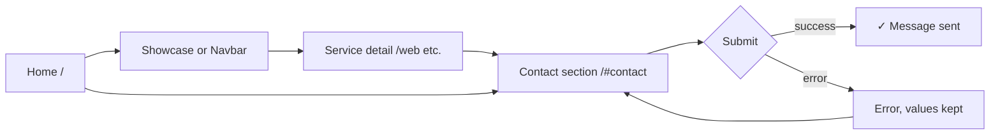
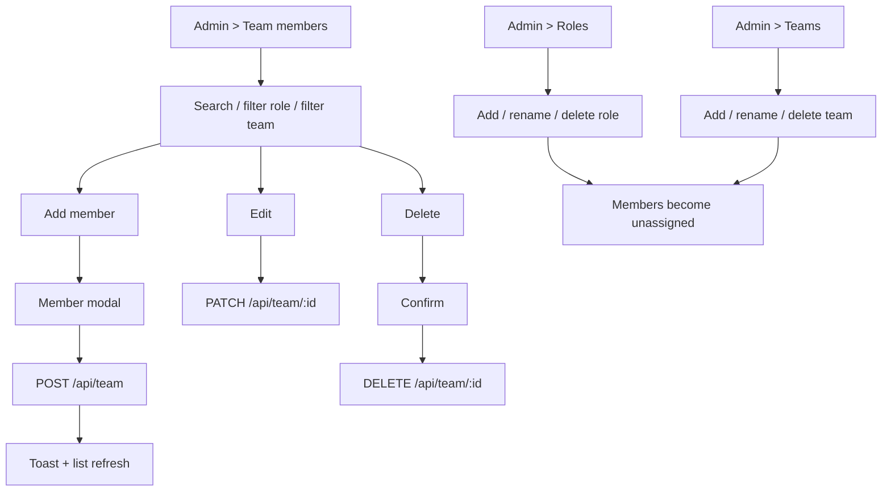
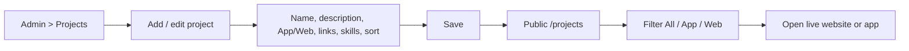
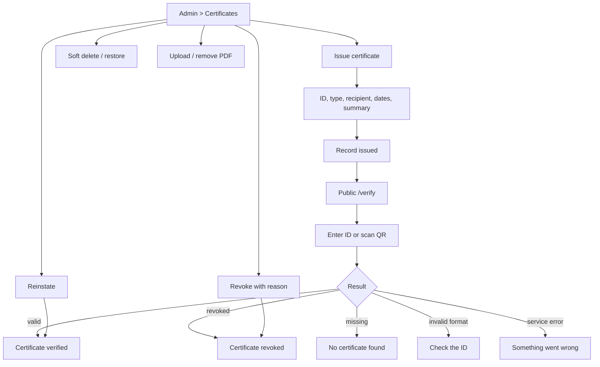
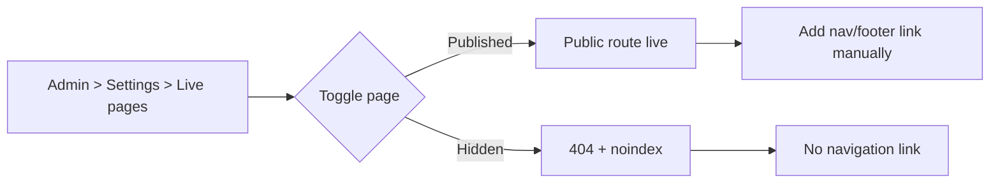
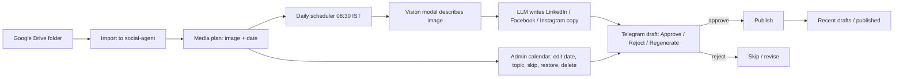

# Kavi Solutions — Design Brief for Google Stitch → Figma

**Status:** Ready for UI design  
**Version:** 1.0 — 14 Nov 2026  
**Owner:** Kavi Solutions  
**Scope:** Public website, gated service pages, authentication/profile, certificate verification, and the admin console.

This document is the single source of truth for recreating the Kavi Solutions product in **Google Stitch** and handing it off to **Figma**. It uses the colours, typography, spacing, and flows that already exist in the application. Do not add new brand colours.

---

## 0. TL;DR

1. Open [Google Stitch](https://stitch.withgoogle.com) and create a project called **Kavi Solutions — Website & Admin**.
2. Paste the **Master Style Prompt** from [`stitch-prompt-pack.md`](stitch-prompt-pack.md) before generating screens.
3. Generate the public pages first (dark navy + blue CTA), then the admin console (light/dark).
4. Export or paste the screens into Figma.
5. Rebuild the generated screens using the components, variables, and frame names in this document.
6. Connect the flows in Figma Prototype using section 9.

**Non-negotiables**

- Primary action colour is `#175CD3` — not Stitch's default purple.
- Public page canvas is `#0B1220` — not pure black.
- Display type is **Space Grotesk**; body type is **Geist**.
- Public cards are glass on dark navy; admin cards are solid shadcn-style surfaces.
- No new colours, no neon, no 3D blobs, no generic AI-purple gradients.

---

## 1. What we are designing

### 1.1 Product context

Kavi Solutions is a senior digital product studio based in India. The site sells engineering, mobile, product, marketing, AI/blockchain, research, financial, government-technology, and farm-tourism services, plus an 11-month fellowship. The same application also contains a private admin console for team, project, certificate, surveyor, and social-media operations.

Scope note: this brief covers the Kavi Solutions **website and admin console**, including responsive mobile-web frames. It does not cover native iOS/Android app screens for client projects.

The design must feel:

- **Premium but not decorative** — dark, calm, technical.
- **Honest** — no hype, no fake client logos, no guaranteed outcomes.
- **Fast** — generous whitespace, clear hierarchy, restrained motion.
- **Human** — real people, real work, plain language.

### 1.2 Routes and status

| Area | Route | Status | Design priority |
| --- | --- | --- | --- |
| Home | `/` | Live | P0 |
| Service detail | `/web`, `/mobile`, `/product`, `/marketing`, `/ai-blockchain` | Live | P0 |
| Projects | `/projects` | Live | P0 |
| Fellowship | `/fellowship` | Live | P0 |
| Team | `/team` | Live | P0 |
| Login | `/login` | Live | P0 |
| Member profile | `/profile` | Live, auth-gated | P1 |
| Certificate verification | `/verify`, `/verify/[id]` | Live | P0 |
| Survey & Research | `/survey` | Built, hidden until admin publishes | P1 |
| Financial Services | `/financial` | Built, hidden until admin publishes | P1 |
| Government Technology | `/government` | Built, hidden until admin publishes | P1 |
| Kavi Farms | `/farms` | Built, hidden until admin publishes | P1 |
| Admin console | `/admin?section=...` | Live, admin-only | P0 |

The four hidden pages must **not** appear in the navbar until an admin publishes them. In Figma, design them as optional nav items behind a "Published" variant.

### 1.3 Source of truth

| What | File |
| --- | --- |
| Global colours, glass, shadows, admin tokens | `app/app/globals.css` |
| Fonts | `app/app/layout.tsx` |
| Homepage composition | `app/app/page.tsx`, `app/components/Hero.tsx`, `Showcase.tsx`, `EmergingTech.tsx`, `Features.tsx`, `Fellowship.tsx`, `Team.tsx`, `Contact.tsx` |
| Service template | `app/components/ServicePage.tsx`, `app/lib/services-data.ts` |
| Projects / Team | `app/app/projects/page.tsx`, `app/app/team/page.tsx` |
| Fellowship page | `app/components/FellowshipPage.tsx`, `app/lib/fellowship-data.ts` |
| Login / Profile | `app/app/login/page.tsx`, `app/app/profile/page.tsx` |
| Certificate verification | `app/app/verify/verify-client.tsx`, `app/lib/certificates.ts` |
| Admin console | `app/app/admin/page.tsx`, `app/components/admin/SocialPanel.tsx` |
| Gated vertical pages | `app/components/{Survey,Financial,Government,Farms}Page.tsx` and matching `*-data.ts` |
| Token export | `docs/design/kavi-design-tokens.json` |
| Copy-paste Stitch prompts | `docs/design/stitch-prompt-pack.md` |

---

## 2. Brand and visual direction

### 2.1 Design principles

1. **Dark canvas, few accents.** The page is near-black navy; colour is reserved for actions, status, and the vertical being viewed.
2. **Glass, not chrome.** Cards are translucent dark surfaces with a hairline border and a soft shadow. Avoid heavy bevels and bright gradients on containers.
3. **One primary action per view.** Solid `#175CD3` button. Secondary actions are glass/outline.
4. **Type does the work.** Large Space Grotesk headings, quiet Geist body copy. No all-caps paragraphs.
5. **Motion is a hint.** Reveal on scroll, a 4–8 px lift on hover, slow floating glow orbs. Nothing bounces or loops aggressively.
6. **Admin is a tool, not a poster.** Dense but calm: sidebar, compact tables, clear filters, one primary action per section.

### 2.2 Avoid

- Stitch's default purple/magenta palette.
- Pure black `#000000` page backgrounds (use `#0B1220`).
- Neon glows, rainbow gradients, 3D blobs, glassmorphism on every element.
- Generic stock photos of people shaking hands or "AI brains".
- Fake dashboards, fake client logos, fake testimonials.
- Rounded cards inside rounded cards inside rounded cards.
- More than two font families.
- Uppercase body text; long letter-spaced paragraphs.

### 2.3 Imagery

- Public pages: product screenshots, real project cards, abstract glow orbs, and emoji/icon tiles already used by the app.
- Team: real portraits when available; otherwise initials on the member's chosen gradient.
- Farms: real farm photography is pending — use labelled placeholders, not stock photos.
- Do not generate photorealistic people's faces for the team grid.

---

## 3. Colour system

All values below come from the running application. Exact CSS is in `app/app/globals.css` and the component files. Tokens are exported in `kavi-design-tokens.json`.

### 3.1 Public site — core palette

| Token | Hex | Usage |
| --- | --- | --- |
| Ink | `#0B1220` | Page background |
| Ink Soft | `#111C2E` | Stat tiles, raised panels inside sections |
| Deep | `#06060F` | Logo tile background, deepest overlay |
| Text primary | `#F7F9FC` | Headings and high-emphasis text |
| Mist | `#A5B3C7` | Body copy, secondary labels |
| Fog | `#7889A0` | Captions, metadata, footer text |
| Accent text | `#91B4FF` | Highlighted words, text links, `text-gradient` class |
| Primary CTA | `#175CD3` | Solid primary buttons and "Let's Talk" |
| Primary hover | `#1849A9` | Hover / pressed primary button |
| White 3% | `#FFFFFF08` | Quiet fills |
| White 5% | `#FFFFFF0D` | Icon tiles, secondary chips |
| White 10% | `#FFFFFF1A` | Hover fills, dividers |
| White 15% | `#FFFFFF26` | Secondary button border |
| Glass fill | `rgba(18, 29, 47, 0.84)` | Glass card background |
| Glass border | `rgba(148, 163, 184, 0.14)` | 1 px glass card border |
| Glow | `rgba(59, 130, 246, 0.72)` | Soft button/card glow |
| Selection | `rgba(139, 92, 246, 0.40)` | Text selection only |

**Important:** despite the class name `text-gradient`, the highlighted words are a **solid** light blue `#91B4FF`. Do not render a gradient on headlines unless a vertical-specific gradient is explicitly specified.

### 3.2 Public site — semantic colours

| Token | Hex | Usage |
| --- | --- | --- |
| Success | `#34D399` / soft `#6EE7B7` | Form success, valid certificate |
| Warning | `#FBBF24` | Pending, revoked notice, caution |
| Error | `#F87171` / strong `#EF4444` | Form error, access denied |
| Info | `#38BDF8` | Informational chips |
| Verified surface | `rgba(16, 185, 129, 0.10)` + `rgba(16, 185, 129, 0.30)` border | Valid certificate banner |
| Revoked surface | `rgba(239, 68, 68, 0.10)` + `rgba(239, 68, 68, 0.30)` border | Revoked certificate banner |

### 3.3 Vertical accent gradients

Vertical colour is used **only** for the hero glow orbs, the small tag pill, icon tile, process-step number, and the final CTA panel. It is never the page background.

| Vertical | From | To | Route |
| --- | --- | --- | --- |
| Web development | `#8B5CF6` violet-500 | `#A855F7` purple-500 | `/web` |
| Mobile development | `#0EA5E9` sky-500 | `#06B6D4` cyan-500 | `/mobile` |
| Digital product | `#D946EF` fuchsia-500 | `#EC4899` pink-500 | `/product` |
| Digital marketing | `#10B981` emerald-500 | `#14B8A6` teal-500 | `/marketing` |
| AI & blockchain | `#8B5CF6` violet-500 | `#06B6D4` cyan-500 | `/ai-blockchain` |
| Survey & research | `#14B8A6` teal-500 | `#10B981` emerald-500 | `/survey` |
| Financial services | `#10B981` emerald-500 | `#14B8A6` teal-500 | `/financial` |
| Government technology | `#2563EB` blue-600 | `#06B6D4` cyan-500 | `/government` |
| Kavi Farms | `#10B981` emerald-500 | `#84CC16` lime-500 | `/farms` |
| Fellowship | `#7C3AED` violet-600 | `#0EA5E9` sky-500 | `/fellowship` |

Additional homepage accents already in use:

| Element | From | To |
| --- | --- | --- |
| Showcase — Engineering | `#8B5CF6` | `#0EA5E9` |
| Showcase — Growth | `#10B981` | `#14B8A6` |
| Showcase — Fellowship | `#7C3AED` | `#D946EF` |
| Showcase — Selected work | `#F59E0B` | `#F97316` |
| Emerging tech — AI card | `#8B5CF6` | `#D946EF` |
| Emerging tech — Blockchain card | `#06B6D4` | `#0EA5E9` |
| Why Kavi card tops | violet→indigo, sky→cyan, emerald→teal, fuchsia→pink | — |

Team card gradients (the 8 swatches in the profile/admin gradient picker):

| Swatch | From | To |
| --- | --- | --- |
| Violet | `#8B5CF6` violet-500 | `#A855F7` purple-500 |
| Sky | `#0EA5E9` sky-500 | `#06B6D4` cyan-500 |
| Emerald | `#10B981` emerald-500 | `#14B8A6` teal-500 |
| Fuchsia | `#D946EF` fuchsia-500 | `#EC4899` pink-500 |
| Amber | `#F59E0B` amber-500 | `#F97316` orange-500 |
| Rose | `#F43F5E` rose-500 | `#EF4444` red-500 |
| Indigo | `#6366F1` indigo-500 | `#3B82F6` blue-500 |
| Lime | `#84CC16` lime-500 | `#22C55E` green-500 |

### 3.4 Brand logo

The logo uses a three-stop gradient on a near-black tile:

| Stop | Hex |
| --- | --- |
| Start | `#2563EB` |
| Middle | `#06B6D4` |
| End | `#8B5CF6` |
| Tile background | `#06060F` |

The logo mark is the letter **K** drawn with rounded strokes, plus small pixel squares in the upper-right. Use the existing SVG (`app/public/logo.svg`) in Figma. Stitch may approximate the mark in generated screens; replace it with the SVG during handoff.

### 3.5 Admin console — light theme

Source: `:root` in `globals.css`. Values are exact CSS HSL; use them as-is in Figma variables.

| Token | Value | Usage |
| --- | --- | --- |
| Background | `hsl(210 40% 98%)` | App canvas |
| Foreground | `hsl(222.2 47.4% 11.2%)` | Primary text |
| Card | `#FFFFFF` | Cards, sidebar, topbar |
| Primary | `hsl(221.2 83.2% 53.3%)` | Primary buttons, active nav |
| Primary foreground | `hsl(210 40% 98%)` | Text on primary |
| Secondary / muted / accent | `hsl(210 40% 96.1%)` | Quiet fills |
| Muted foreground | `hsl(215.4 16.3% 46.9%)` | Secondary text |
| Destructive | `hsl(0 84.2% 60.2%)` | Delete, errors |
| Border | `hsl(214.3 31.8% 91.4%)` | Card and table borders |
| Input | `hsl(214.3 31.8% 88%)` | Input borders |
| Ring | `hsl(221.2 83.2% 53.3%)` | Focus ring |
| Radius | `0.625rem` (10 px) | Base admin radius |

### 3.6 Admin console — dark theme

Admin defaults to dark. Design both themes; dark is the reference.

| Token | Value |
| --- | --- |
| Background | `hsl(222 47% 7%)` |
| Foreground | `hsl(210 40% 98%)` |
| Card | `hsl(222 40% 11%)` |
| Primary | `hsl(217.2 91.2% 59.8%)` |
| Primary foreground | `hsl(210 40% 98%)` |
| Secondary | `hsl(217.2 32.6% 16%)` |
| Muted | `hsl(217.2 32.6% 15%)` |
| Muted foreground | `hsl(215 20.2% 65.1%)` |
| Accent | `hsl(217.2 32.6% 18%)` |
| Destructive | `hsl(0 62.8% 50.6%)` |
| Border | `hsl(217.2 32.6% 18%)` |
| Input | `hsl(217.2 32.6% 22%)` |
| Ring | `hsl(217.2 91.2% 59.8%)` |

### 3.7 Usage ratio

- **70%** Ink / Ink Soft / admin background.
- **20%** white text, mist, fog, borders.
- **10%** primary blue and semantic/vertical accents.

Never use the accent gradients as full-page backgrounds or on long text.

---

## 4. Typography

| Style | Font | Size / line-height | Weight | Usage |
| --- | --- | --- | --- | --- |
| Hero XL | Space Grotesk | 72 / 1.08 px | 700 | Home hero, large desktop |
| Hero L | Space Grotesk | 60 / 1.1 px | 700 | Home hero tablet, service/fellowship page heroes desktop |
| Page H1 | Space Grotesk | 48 / 1.1 px | 700 | Team/Projects H1, section titles desktop |
| Section H2 mobile | Space Grotesk | 30 / 1.2 px | 700 | Section headings below `sm` |
| Card H3 | Space Grotesk | 24 / 1.3 px | 600 | Card titles |
| Body large | Geist | 18 / 1.7 px | 400 | Hero subcopy |
| Body | Geist | 16 / 1.7 px | 400 | Paragraphs |
| Small | Geist | 14 / 1.6 px | 400/500 | Card copy, nav |
| Caption | Geist | 12 / 1.5 px | 400/500 | Metadata, stat labels |
| Eyebrow | Geist | 11 / 1.4 px, uppercase, `0.2em` tracking | 600 | Section tags and pills |

On mobile, the hero drops to **36 px** and section titles to **30 px**. Page heroes drop to **36 px**.

Rules:

- Headings use tight tracking (`-0.02em`) on desktop.
- Body copy is `#A5B3C7` on dark; never pure white for long paragraphs.
- Admin UI uses **Geist** throughout; bold section titles, 13–14 px table text.
- Buttons use 14 px Geist, semibold (600).
- Do not use more than 2 weights per screen.

---

## 5. Layout, spacing, radius, elevation

### 5.1 Public layout

| Item | Value |
| --- | --- |
| Desktop frame | 1440 px wide, auto height |
| Mobile frame | 390 × 844 px |
| Content container | 1152 px max (`max-w-6xl`) |
| Hero copy width | 896 px max (`max-w-4xl`) |
| Section padding | 96 px vertical; 128 px on large sections |
| Page side padding | 24 px mobile, 24 px desktop |
| Navbar | Floating, 16 px from top, 1152 px max, 12 px radius, 20 px horizontal padding, 12 px vertical |
| Grid | 12-column mental model; 2 columns tablet, 1 column mobile |
| Card gap | 20–24 px |

### 5.2 Admin layout

| Item | Value |
| --- | --- |
| Desktop frame | 1440 px wide |
| Sidebar | 256 px fixed, full height |
| Top bar | 64 px sticky |
| Main content | 1152 px max, 32 px side padding |
| Table row | 48–56 px |
| Card padding | 24 px |
| Section gap | 32 px |
| Mobile | Sidebar becomes a drawer; tables become stacked cards or horizontally scroll |

### 5.3 Radii

| Element | Public | Admin |
| --- | --- | --- |
| Large cards | 24 px | 8 px |
| Medium cards / panels | 16 px | 8 px |
| Buttons | 12 px | 6 px |
| Inputs / selects | 12 px | 6 px |
| Navbar | 12 px | — |
| Pills / badges | 999 px | 999 px |
| Icon tiles | 12–16 px | 8–12 px |

### 5.4 Elevation

| Token | Value |
| --- | --- |
| Glow | `0 8px 24px -14px rgba(59, 130, 246, 0.72)` |
| Lift | `0 1px 2px rgba(0,0,0,0.24), 0 18px 42px -24px rgba(0,0,0,0.62)` |
| Glass blur | `blur(16px)` |
| Focus ring | 2 px `#2563EB` (admin) or `#91B4FF` (public) at 40% opacity |

### 5.5 Motion

| Interaction | Behaviour |
| --- | --- |
| Section reveal | Fade + 24 px upward, 0.5–0.7 s, staggered 0.08 s |
| Card hover | `translateY(-4px)` to `-8px`, shadow increases |
| Primary button hover | Background darkens; optional `scale(1.02)` |
| Glow orbs | Float 22 px over 9–14 s, slow |
| Mobile menu | Slide in from right, 288 px wide, spring damping |
| Respect reduced motion | Disable reveals and float animations |

---

## 6. Component inventory

### 6.1 Public components

| Component | Variants / states | Notes |
| --- | --- | --- |
| Navbar | Logged out / member / admin; mobile drawer | Glass, floating, short links: Showcase, Projects, Fellowship, Team + auth + Let's Talk |
| Primary button | Default, hover, loading, disabled | Solid `#175CD3`, 12 px radius |
| Secondary button | Glass / outline | `bg-white/[0.03]`, 1 px white 15% border |
| Pill badge | Default, vertical accent | 999 px, uppercase 11 px, optional dot |
| Stat strip | 4 tiles | Joined grid with 1 px white/10 gaps, Ink Soft tiles |
| Showcase card | Default, hover | 24 px radius, icon tile, tag pill, link chips, CTA arrow |
| Feature card | Default, hover | Top accent bar, icon tile, title, copy |
| Team card | Photo / initials; with links | 24 px radius, centered, role in blue |
| FAQ accordion | Closed / open | `details` style, + rotates 45° |
| Form input | Default, focus, error, filled | Glass fill, 1 px white/10, 12 px radius |
| Select / textarea | Default, focus | Native select styled dark |
| Contact form | Idle, sending, sent, error | Keeps values on error, resets on success |
| Status notice | Success / warning / error | Soft tinted surface + icon |
| Footer | Default | Logo, services, links, copyright |
| Mobile menu | Closed / open | Right drawer, backdrop, auth block |

### 6.2 Admin components

| Component | Variants / states | Notes |
| --- | --- | --- |
| App shell | Light / dark | Sidebar + sticky top bar + main |
| Sidebar item | Default, hover, active, badge count | Active = primary/10 + primary border |
| Page header | Title + description + actions | Eyebrow "Workspace / Administration" |
| Card | Default, stat, form | Solid card background, 8 px radius |
| Table | Header, rows, hover, empty | Compact, 13–14 px |
| Badge | Neutral, primary, success, warning, destructive | 999 px for status |
| Modal | Add/edit, confirm, destructive | Centered, backdrop, 24 px padding |
| Dialog | Revoke, delete, remove admin | Short, explicit consequence copy |
| Form controls | Input, select, textarea, toggle | 6 px radius, 36–40 px height |
| Gradient picker | 8 swatches, selected | Team card colours |
| Toast / notice | Success, error | Top-right or inline, auto-dismiss 3.5 s |
| Empty state | Icon + title + body + action | No data, no results, errors |
| Loading | Spinner + "Loading workspace…" | Centered, branded tile |
| Theme toggle | Light / dark | Sun/moon icon in top bar |
| Mobile drawer | Closed / open | 256 px, backdrop |

---

## 7. Screen inventory

### 7.1 Public screens

| ID | Screen | Route | Frame | Prompt |
| --- | --- | --- | --- | --- |
| P01 | Home | `/` | Desktop 1440 + Mobile 390 | P01 |
| P02 | Service detail template | `/web` (repeat for 4 others) | Desktop 1440 | P02 |
| P03 | Projects | `/projects` | Desktop 1440 | P03 |
| P04 | Fellowship | `/fellowship` | Desktop 1440 | P04 |
| P05 | Team | `/team` | Desktop 1440 | P05 |
| P06 | Login | `/login` | Desktop 1440 + Mobile 390 | P06 |
| P07 | Member profile | `/profile` | Desktop 1440 | P07 |
| P08 | Certificate verification | `/verify`, `/verify/[id]` | Desktop 1440 + Mobile 390 | P08 |
| P09 | Survey & Research | `/survey` | Desktop 1440 | P09 |
| P10 | Financial Services | `/financial` | Desktop 1440 | P10 |
| P11 | Government Technology | `/government` | Desktop 1440 | P11 |
| P12 | Kavi Farms | `/farms` | Desktop 1440 | P12 |
| P13 | Contact form states | `/#contact` | Desktop 1440 | P13 |

### 7.2 Admin screens

| ID | Screen | Section | Frame | Prompt |
| --- | --- | --- | --- | --- |
| A01 | Admin access states | `/admin` gate | Desktop 1440 | A01 |
| A02 | Team members | `?section=team` | Desktop 1440 + Mobile 390 | A02 |
| A03 | Roles and teams | `?section=roles`, `?section=teams` | Desktop 1440 | A03 |
| A04 | Projects | `?section=projects` | Desktop 1440 | A04 |
| A05 | Certificates | `?section=certificates` | Desktop 1440 | A05 |
| A06 | Surveyors | `?section=surveyors` | Desktop 1440 | A06 |
| A07 | Social agent | `?section=social` | Desktop 1440 | A07 |
| A08 | Administrators | `?section=admins` | Desktop 1440 | A08 |
| A09 | Settings and live pages | `?section=settings` | Desktop 1440 | A09 |
| A10 | Member add/edit modal | Team | Desktop overlay | A10 |
| A11 | Certificate issue/revoke | Certificates | Desktop overlay | A11 |
| A12 | Project add/edit modal | Projects | Desktop overlay | A12 |
| A13 | Surveyor add/edit modal | Surveyors | Desktop overlay | A13 |

---

## 8. Screen specifications

### P01 — Home

**Purpose:** Convince a visitor that Kavi ships serious digital products, then route them to work, services, fellowship, or contact.

**Layout:** Long dark page. Floating glass navbar. Hero fills the first viewport. Alternate full-width sections with 1152 px content.

**Sections, in order:**

1. **Navbar** — logo + wordmark; links Showcase, Projects, Fellowship, Team; auth control; solid "Let's Talk" button to `/#contact`. Mobile: hamburger → right drawer.
2. **Hero** — centered. Pill: "Digital product studio · India & beyond". H1: "Ideas become experiences. We build the rest." Subcopy: full-stack digital studio crafting web apps, native mobile apps, product experiences and growth marketing. Buttons: "Start your project →" (primary), "Explore services" (glass). Four stat tiles: `120+ Projects shipped`, `40+ Happy clients`, `6+ Years crafting`, `99% On-time delivery`.
3. **Showcase** — eyebrow "Showcase", H2 "Four doors into the work", four glass cards: Engineering & technology, Growth & marketing, Kavi Fellowship, Selected work. Each has icon, tag pill, title, description, 3–4 link chips, CTA arrow.
4. **Emerging tech** — eyebrow "Emerging technology", H2 "AI and blockchain, without the theatre", two large glass cards with glow orbs: AI and Blockchain. Each has title, description, capability chips, "Explore capability →".
5. **Why Kavi** — H2 "Built to impress. Engineered to last." Four cards with top accent bar: Performance first, Design that sells, Secure by default, Shipped to scale.
6. **Fellowship teaser** — eyebrow "Fellowship", H2 "Launch your career with Kavi Fellows", three cohort pills (January 2027, May 2027, September 2027), four cards (Mentorship, Build in public, Network, Opportunities), CTA "Apply for the fellowship →".
7. **Team** — H2 "The people behind the magic", member grid (photo or initials on gradient), name, role, LinkedIn/portfolio links.
8. **Contact** — split layout. Left: eyebrow "Let's talk", H2 "Have a project in mind? Let's build it.", email `kavisolutions1@gmail.com`, location "Worldwide · Remote-first". Right: glass form (name, email, phone, service select, message, "Send message →"). Soft sky/violet glow orbs behind.
9. **Footer** — logo, "Web · Mobile · Product · Marketing · AI · Fellowship", links including Showcase and Team Admin, copyright.

**States:** logged-out nav (Login), member nav (My Profile, Logout), admin nav (Admin Panel, Logout). Form idle/sending/sent/error. Hover lift on cards. Mobile drawer.

**Notes:** Do not add a separate services grid — Showcase replaced it. Keep the hero stat strip joined, not four detached cards.

---

### P02 — Service detail template

**Purpose:** Explain one capability and convert to contact.

**Use one template for:** Web, Mobile, Product, Marketing, AI & Blockchain. Swap the vertical gradient and copy from `services-data.ts`.

**Sections:**

1. Hero — centered, vertical tag pill with icon, H1 two-part ("Websites & web apps" + accent "that win customers"), subcopy, two CTAs ("Start your project →", "Explore features"), four metric tiles.
2. Features — "What we build", 8 cards in 4 columns desktop / 2 tablet / 1 mobile. Each icon tile, title, description.
3. Process — 5 stacked glass rows. Gradient number tile, title, description.
4. Stack — centered chips of technologies/tools.
5. FAQ — 4 accordion rows.
6. CTA — full-width gradient panel with white heading, description, white button "Get in touch →".

**States:** FAQ open/closed; card hover; mobile stacked.

---

### P03 — Projects

**Purpose:** Show shipped work and let visitors filter by App/Web.

**Sections:**

1. Header — wordmark, H1 "Our Projects" with accent, subcopy.
2. Filters — three pills: All, App, Web. Active = primary gradient/blue; inactive = white/5.
3. Grid — 2 columns desktop, 1 mobile. Each card: rocket icon tile, type badges (App/Web), project name, description, skill chips, footer links "Visit website" / "Open app".
4. CTA — "Want a project like these? Let's talk".

**States:** loading, error, empty ("Projects are being updated"), filtered empty ("No App projects yet"), card hover lift.

---

### P04 — Fellowship

**Purpose:** Explain the 11-month programme honestly and collect interest.

**Sections:**

1. Hero — violet/sky orbs, tag "Fellowship · Kavi Fellows", H1, subcopy, CTAs "Register your interest →", "See the 11-month journey", four metrics, footnote "English primary · Telugu support · No placement guarantee".
2. Who it's for — H2 "If you are willing to do the work, the door is open".
3. Three pillars — Vipassana, YLTP, DSN.
4. Curriculum — 11-month journey: Foundation (1–2), Craft (3–5), Practice (6–8), Specialise (9–10), Capstone & launch (11).
5. Weekly rhythm — a shaped week.
6. Tracks — Technology, Research & field operations, Marketing & communications, Operations & finance.
7. Mentors & language — mentor cards, English primary/Telugu support.
8. Cohorts — next intake.
9. FAQ — honest answers: no placement guarantee, no salary promise, Vipassana compulsory, fees explained in conversation.
10. Apply — solid `#175CD3` CTA panel to contact form.

**States:** FAQ open/closed; mobile stacked timeline.

---

### P05 — Team

**Purpose:** Show the people and let members/admins manage profiles.

**Sections:**

1. Header — wordmark, H1 "Meet the Team", tagline from settings.
2. Summary strip — member count card; "Manage team →" for admins; "Edit my profile →" for members.
3. Grid — 4 columns desktop, 2 tablet, 1 mobile. Photo/initials, name, role, LinkedIn, portfolio.
4. Empty/error states.

---

### P06 — Login

**Purpose:** Authenticate team members and admins.

**Layout:** Centered dark glass card, max 448 px, on Ink. Logo wordmark above. H1 "Login". Subcopy "Sign in to manage your team profile and the website."

**Elements:** email input, password input, error text, primary "Sign in" button, divider "or", white "Continue with Google" button with Google mark, support note with `support@kavisolutions.in`, "← Back to home".

**States:** loading, signing in (disabled), invalid credentials, Google redirecting, generic error.

---

### P07 — Member profile

**Purpose:** Let a signed-in team member edit their public card.

**Layout:** Centered card, max 672 px, on Ink. Logo, H1 "My Profile", "Signed in as …".

**Elements:** avatar (photo or gradient initials) + "Change photo"; name; role select; portfolio URL; LinkedIn URL; team (read-only if set); "Card colour" gradient picker with 8 swatches; bio textarea; Save profile; View team page; Sign out.

**States:** logged out CTA, loading, no team profile ("Ask an admin to add you"), upload in progress, save success/error.

---

### P08 — Certificate verification

**Purpose:** Prove a certificate is genuine without exposing private data.

**Layout:** Max 768 px, Ink background. Wordmark, eyebrow "Certificate verification", H1 "Verify a Kavi Solutions certificate", explanatory copy.

**Elements:** certificate ID input (monospace, uppercase, placeholder `KV-FEL-2026-0001`), "Verify" button. Result card below.

**Result states:**

1. **Idle** — no result.
2. **Loading** — button "Checking…", disabled.
3. **Valid** — emerald banner "Certificate verified", check icon, certificate ID; body: seal label, title, awarded to, programme, role, period, issued on, type, summary. No public PDF download; the PDF is an internal/printed artefact.
4. **Revoked** — red banner "Certificate revoked", warning icon, reason/date if shown, same metadata.
5. **Not found** — amber warning "No certificate found" with the submitted ID.
6. **Invalid format** — amber warning "Check the ID" with reason.
7. **Service error** — red notice "Something went wrong" + retry.

**Flow note:** `/verify/[id]` is the QR deep link; it resolves automatically on mount.

---

### P09 — Survey & Research (gated)

**Accent:** teal → emerald.

**Sections:** Hero + 4 metrics; Approach (5 steps); Six research verticals; Market research band; Field operations & network; Data analysis & reporting; Predictive research; Academic support; Engagement models (5); Industries + opportunities (framed as "under discussion", not clients); Join network + client enquiry; FAQ blocks; contact.

**Form:** Glass card with a two-tab switch: **Client / project enquiry** and **Join our survey network**. Client fields: name, email, phone, organisation, service, message. Surveyor fields: name, email, phone, location, languages, experience, about. States idle/sending/sent/error.

---

### P10 — Financial Services (gated)

**Accent:** emerald → teal.

**Sections:** Hero + 4 metrics; Approach (5 steps); Two tracks (individual/business); Individual services (4); Business services (4); Tax planning; Investment planning; Financial planning; Cash flow management; Trust & compliance; Client types; Enquiry + FAQ + contact.

**Form:** Two-tab switch **Individual** / **Business**. Common: name, email, phone, message. Individual: service, financial year. Business: organisation, financial year, entity type, service. Include the compliance note and "do not send financial documents through this form".

---

### P11 — Government Technology (gated)

**Accent:** blue-600 → cyan.

**Sections:** Hero + metrics; Approach; Focus areas; Platform directory (assessment candidates, not clients); POLYCET reference journey (notification → admission); Assessment framework; Security (written authorisation only); Capabilities; FAQ; Enquiry.

**Form:** name, email, phone, organisation/department, role, portal name/URL, service, message.

---

### P12 — Kavi Farms (gated)

**Accent:** emerald → lime.

**Sections:** Hero + metrics; About; Farm products ("Grown here, packed here", "Price on enquiry"); Farm tourism ("Three days in a real village"); Itinerary; Destinations; Gallery placeholder; FAQ; Enquiry.

**Form:** Two-tab switch **Farm products** / **Village visit**. Product: product, quantity. Tourism: month, group size, service. Common: name, email, phone, message. Prices remain "Price on enquiry".

---

### P13 — Contact form states

Four frames of the same component:

1. **Idle** — empty fields, primary "Send message →".
2. **Sending** — disabled button, "Sending...".
3. **Success** — "✓ Message sent!", fields reset, quiet emerald confirmation.
4. **Error** — red "Something went wrong. Please try again.", fields retained.

Fields: name, email, phone, service (Web development, Mobile app, Digital product, Digital marketing, Fellowship, Something else), message.

---

### A01 — Admin access states

Three frames:

1. **Loading** — Ink/background canvas, centered blue-tinted icon tile with spinner, "Loading workspace…".
2. **Signed out** — max 448 px card, "K" tile, "Admin Portal", "Sign in with an authorised administrator account…", primary "Sign In to Continue" → `/login?next=/admin`, link "← Return to public team page".
3. **Access denied** — red shield tile, "Access Denied", "`email` is not listed as an administrator for Kavi Solutions.", outline "Sign out", return link.

---

### A02 — Admin shell + Team members

**Shell:** 256 px sidebar with logo, "Kavi Solutions" / green dot "Admin Console"; workspace nav: Team members, Roles, Teams, Projects, Certificates, Surveyors, Social agent, Administrators, Settings. Count badges. User card at bottom with email, "Administrator", logout. Sticky top bar: breadcrumb `Kavi Solutions > Workspace > Team members`, theme toggle, "Live team page ↗". Main: eyebrow "Workspace / Administration", H1, description, member count badge, "Add member" primary.

**Team content:** search field; role filter; team filter; table with avatar/name/email, role chip, team chip, sort order, actions (edit, delete). Empty state. Row hover.

**States:** loading, table, filtered empty, no members, saving, toast.

---

### A03 — Roles and teams

Two management screens sharing a pattern:

- Card with title + description, inline "Add role/team" input + button.
- List rows: name, member count, rename (inline), delete.
- Delete confirm explains that members become unassigned.
- Empty state.

---

### A04 — Projects admin

- Page header, project count, "Add project".
- Table: Project (name + description), Types (App/Web badges), Links, Order, Actions (edit/delete).
- Add/edit modal: name, description, project types (App/Web checkboxes), app link, web link, skills (add/remove chips), sort order.
- Delete confirm.

---

### A05 — Certificates admin

**Header:** certificate count, "Issue certificate".

**Status filter:** All / Issued / Revoked only / Deleted only, with counts for revoked and deleted. Show a quiet notice row when revoked or deleted records exist.

**Filters:** search by ID/recipient/programme/title; status filter.

**Table:** certificate (ID + type), recipient, programme/period, issued date, status badges, PDF badge, actions: edit, revoke/reinstate, delete/restore, upload/remove PDF, open public verification.

**Issue/edit modal:** ID (`KV-{FEL|VOL|INT|MEN|EXP}-YYYY-NNNN`), type select, recipient name, programme, role, start date, end date, issued on, summary. Inline validation.

**Revoke dialog:** reason textarea, destructive confirm. Explains public verification changes immediately.

**States:** valid, revoked, deleted, PDF attached, saving, error.

---

### A06 — Surveyors admin

- Header with count and "Add surveyor".
- Status filter select: All, Applied, Verified, Active, Inactive, Rejected, with counts.
- Table: Surveyor (name + email + phone), Location, Languages, Status, Actions (edit, verify/activate/reject, delete).
- Add/edit modal: name, email, phone, location, languages (comma-separated), skills, experience, notes, status.
- Workflow note: registrations always arrive as **applied**; moving to verified stamps the date; rejecting clears it.

---

### A07 — Social agent

- Status strip: configured/reachable, timezone, scheduler on/off, next run, auto-publish, vision provider, connected accounts.
- Import card: Google Drive folder link, start date, topic hint, "Import" button; progress with per-file errors.
- Upload card: multi-file image upload.
- Month list (titled "Calendar"): month picker + status filter; one row per image with 80 px thumbnail, status badge, editable date, topic-hint input, description preview, error text, actions (draft now, skip/restore, delete).
- Recent drafts table: topic, caption preview, targets, status, publish button.
- "Run due" secondary action.

---

### A08 — Administrators

- Header, admin count, "Add administrator" email input.
- List: email, source badge (`env` or `db`), remove action.
- Explain that env admins cannot be removed from the UI.
- Confirm before removing.

---

### A09 — Settings and live pages

Two cards:

1. **Company profile** — tagline, description, contact email, Save.
2. **Live pages** — four rows: Survey & Research, Financial Services, Government Technology, Kavi Farms. Each has route, blurb, and a Published toggle that saves immediately. Explain that hidden pages return 404 and have no nav link; publishing takes effect on the next request.

---

### A10 — Member add/edit modal

Centered modal, max 640 px, scrollable. Fields: name, role, team, email + temporary password (add only), bio, profile URL, LinkedIn URL, sort order, image upload with preview, card gradient picker. Footer: Cancel, Save member. Inline error. Destructive delete lives on the row, not in the modal.

### A11 — Certificate issue/revoke overlays

- Issue/edit: form as A05.
- Revoke: small destructive dialog with certificate ID, recipient, reason, Cancel / Revoke.
- Delete/restore: confirm dialog with consequence copy.

### A12 — Project add/edit modal

Name, description, type checkboxes App/Web, app link, web link, skills chip editor, sort order, Cancel / Save. Show which public link button will appear based on type.

### A13 — Surveyor add/edit modal

Name, email, phone, location, languages, skills, experience, notes, status. Cancel / Save. Explain status workflow in helper text.

---

## 9. Flows

Use these diagrams to connect frames in Figma Prototype. Each flow lists the happy path and the important failure/empty states.

### 9.1 Visitor → service → lead



1. Visitor lands on `/`.
2. Clicks a Showcase card, navbar link, footer service link, or "Start your project".
3. Service page CTA returns to `/#contact`.
4. Fills name, email, phone, service, message.
5. Button becomes "Sending..."; success shows "✓ Message sent!" and resets; failure keeps values and shows a red error.

### 9.2 Authentication and role redirect

```mermaid
flowchart TD
  A[Navbar: Login] --> B[/login]
  B --> C{Method}
  C -->|Email + password| D[Session created]
  C -->|Google OAuth| D
  D --> E{Safe next param?}
  E -->|yes| F[Go to next]
  E -->|no| G{/api/me isAdmin?}
  G -->|yes| H[/admin]
  G -->|no| I[/team]
  H --> J{Admin?}
  J -->|no| K[Access denied]
  J -->|yes| L[Admin console]
```

1. Logged-out navbar shows **Login**.
2. Login supports email/password and Google.
3. If `next` is a safe internal path, go there.
4. Otherwise, admins go to `/admin`; members go to `/team`.
5. Logged-in navbar shows **Admin Panel** or **My Profile**, plus **Logout**.
6. `/admin` shows sign-in card when signed out, access-denied card when signed in but not an admin.

### 9.3 Member profile

```mermaid
flowchart LR
  A[/team] --> B{Member?}
  B -->|yes| C[Edit my profile]
  C --> D[/profile]
  D --> E[Edit photo, role, links, bio, gradient]
  E --> F[Save profile]
  F -->|success| G[Profile updated]
  F -->|error| H[Inline error]
  B -->|no| I[Public team view]
```

States: logged out, no member record, upload in progress, save success/error.

### 9.4 Admin team, roles, and teams



### 9.5 Projects



### 9.6 Certificate lifecycle



Rules:

- Certificate ID format: `KV-FEL-2026-0001`, `KV-VOL-…`, `KV-INT-…`, `KV-MEN-…`, `KV-EXP-…`.
- Revocation is visible on public verification immediately (no cache).
- Delete is soft; the record can be restored from the Deleted filter.
- PDFs live in a private bucket; the public page only offers download when attached.

### 9.7 Surveyor lifecycle

```mermaid
flowchart LR
  A[/survey#join-network] --> B[Join our survey network form]
  B --> C[Register]
  C --> D[Status: applied]
  D --> E[Admin > Surveyors]
  E -->|verify| F[Status: verified + verified_at]
  F -->|activate| G[Status: active]
  E -->|reject| H[Status: rejected]
  E -->|return to applied| D
  E -->|inactive| I[Status: inactive]
  G --> I
```

Re-registering with an existing email updates the profile and keeps the status.

### 9.8 Gated page publishing



The switch saves immediately, not on the form's Save button. The check fails closed if the API is unreachable.

### 9.9 Social agent pipeline



### 9.10 Vertical enquiry flows

| Vertical | Tabs | Extra fields | Success | Error |
| --- | --- | --- | --- | --- |
| Survey | Client / Surveyor | Client: organisation, service. Surveyor: location, languages, experience, about | "sent" state; surveyor stored as applied | Inline error + direct email fallback |
| Financial | Individual / Business | Individual: service, financial year. Business: organisation, financial year, entity type, service | "sent" state | Inline error + direct email fallback |
| Government | Single | Organisation, role, portal name/URL, service | "sent" state | Inline error + direct email fallback |
| Farms | Farm products / Village visit | Product: product, quantity. Tourism: month, group size, service | "sent" state | Inline error + direct email fallback |

### 9.11 Admin CRUD summary

| Entity | Create | Read | Update | Delete |
| --- | --- | --- | --- | --- |
| Team member | Add member modal | Searchable table | Edit modal | Confirm → remove |
| Role | Inline add | List | Inline rename | Confirm → members unassigned |
| Team | Inline add | List | Inline rename | Confirm → members unassigned |
| Project | Add project modal | Card/table list | Edit modal | Confirm → delete |
| Certificate | Issue modal | Filtered table + summary | Edit modal | Soft delete → restore; revoke/reinstate |
| Surveyor | Add modal (arrives applied) | Filtered table | Edit modal + status transitions | Confirm → permanent delete |
| Admin | Email input | Source-labelled list | — | Confirm → remove (db only) |
| Settings | — | Form | Save | — |
| Live pages | — | Four toggles | Immediate PATCH | — |

---

## 10. Google Stitch workflow

### 10.1 Setup

1. Go to [stitch.withgoogle.com](https://stitch.withgoogle.com) and sign in with the Google account used for Kavi design work.
2. Create a project: **Kavi Solutions — Website & Admin**.
3. Choose **Web** as the target. Use **Dark** as the base theme; admin screens will be generated separately as light/dark.
4. Paste the **Master Style Prompt** from `stitch-prompt-pack.md`.
5. Generate screens one at a time, in the order below. Do not generate the whole app in one prompt.

### 10.2 Generation order

| Order | Screens | Why |
| --- | --- | --- |
| 1 | P01 Home | Establishes the visual language |
| 2 | P02 Service template | Proves the section system repeats |
| 3 | P03 Projects, P05 Team | Data-driven card grids |
| 4 | P04 Fellowship | Long-form narrative page |
| 5 | P06 Login, P07 Profile, P08 Verify | Auth and status states |
| 6 | P09–P12 gated verticals | Reuse the service template + forms |
| 7 | A02 Admin shell + Team | Establishes admin density |
| 8 | A03–A09 admin sections | Reuse the shell |
| 9 | A10–A13 overlays | Modal patterns |
| 10 | Mobile P01, P02, P06, P08, A02 | Responsive variants |
| 11 | Flow frames | Connect the happy paths |

### 10.3 Prompting rules

- **One screen per prompt.** Long pages (Home, Fellowship, Survey, Financial) can be split into "top half" and "bottom half" and joined in Figma.
- **Always include the palette and fonts** in the prompt, even if the project style is set. Stitch drifts toward purple when unspecified.
- **Say "desktop website screen, 1440 px wide"** explicitly. Otherwise Stitch may produce a mobile app.
- **Use real copy** from this document. Stitch output with lorem ipsum is not useful.
- **Ask for states in separate prompts** (success, error, empty) rather than expecting Stitch to invent them.
- **Use a current screenshot as a style reference** if available. Upload a home-page screenshot and say "match this layout language, but apply the palette above".
- **Correct drift immediately:** "Recolour the primary button to #175CD3, the page background to #0B1220, and remove all purple-pink gradients not listed in the palette."

### 10.4 What Stitch is good at vs. what to rebuild

| Good for | Rebuild in Figma |
| --- | --- |
| Layout exploration, section rhythm, first-pass composition | Exact spacing, type scale, variables |
| Copy hierarchy and density | Component variants and interactive states |
| Card/grid ideas | Auto layout and constraints |
| Mobile reflow ideas | Real responsive behaviour |
| Flow screen sequencing | Prototype wiring and edge cases |

Stitch output is a **starting point**, not production UI. Rebuild it with the tokens and components in this document.

---

## 11. Figma handoff

### 11.1 File structure

Create one Figma file with these pages:

| Page | Contents |
| --- | --- |
| `00 Cover` | Project name, version, links, status |
| `01 Foundations` | Colour variables, type styles, spacing, radii, shadows, iconography |
| `02 Components` | Public and admin component sets with variants |
| `03 Public` | P01–P13 desktop frames |
| `04 Admin` | A01–A13 desktop frames, light and dark |
| `05 Mobile` | 390 px frames for key public and admin screens |
| `06 Flows` | Flow frames with annotations and prototype links |
| `07 Archive` | Stitch exports and discarded explorations |

### 11.2 Frame naming

Use zero-padded IDs so frames sort correctly:

```
P01 · Home · Desktop 1440
P01 · Home · Mobile 390
P02 · Service – Web · Desktop 1440
...
A02 · Team members · Light 1440
A02 · Team members · Dark 1440
A02 · Team members · Mobile 390
F01 · Lead flow · 01 Home
F01 · Lead flow · 02 Contact filled
F01 · Lead flow · 03 Success
```

### 11.3 Variables

Create a Figma variable collection with three modes:

1. **Public / Dark** — the main marketing palette.
2. **Admin / Light** — shadcn light tokens.
3. **Admin / Dark** — shadcn dark tokens.

Map semantic names to primitives:

| Semantic | Public | Admin Light | Admin Dark |
| --- | --- | --- | --- |
| `surface/canvas` | `#0B1220` | `hsl(210 40% 98%)` | `hsl(222 47% 7%)` |
| `surface/raised` | `#111C2E` | `#FFFFFF` | `hsl(222 40% 11%)` |
| `surface/glass` | `rgba(18,29,47,0.84)` | — | — |
| `text/primary` | `#F7F9FC` | `hsl(222.2 47.4% 11.2%)` | `hsl(210 40% 98%)` |
| `text/secondary` | `#A5B3C7` | `hsl(215.4 16.3% 46.9%)` | `hsl(215 20.2% 65.1%)` |
| `text/caption` | `#7889A0` | `hsl(215.4 16.3% 46.9%)` | `hsl(215 20.2% 65.1%)` |
| `action/primary` | `#175CD3` | `hsl(221.2 83.2% 53.3%)` | `hsl(217.2 91.2% 59.8%)` |
| `action/primary-hover` | `#1849A9` | primary at 90% opacity | primary at 90% opacity |
| `border/default` | `rgba(255,255,255,0.10)` | `hsl(214.3 31.8% 91.4%)` | `hsl(217.2 32.6% 18%)` |
| `status/success` | `#34D399` | `#059669` | `#34D399` |
| `status/warning` | `#FBBF24` | `#B45309` | `#FCD34D` |
| `status/error` | `#F87171` | `destructive` | `#F87171` |

The JSON in `kavi-design-tokens.json` contains the full set. Import with Tokens Studio or map manually.

### 11.4 Type styles

Create text styles for Hero XL/L, Page H1, Section H2, Card H3, Body Large, Body, Small, Caption, Eyebrow. Set font families to **Space Grotesk** and **Geist**. If Geist is unavailable in the Figma environment, use **Inter** only as a temporary fallback and note it.

### 11.5 Component sets

Build these before laying out screens:

**Public**

- `Button / Primary` — Default, Hover, Loading, Disabled
- `Button / Secondary` — Default, Hover
- `Badge / Pill` — Neutral, Vertical, Status
- `Card / Glass` — Default, Hover, Feature, Showcase, Team
- `Stat / Tile`
- `Nav / Desktop` — Logged out, Member, Admin
- `Nav / Mobile drawer`
- `Form / Input` — Default, Focus, Error, Filled
- `Form / Select`, `Form / Textarea`
- `Accordion / FAQ` — Closed, Open
- `Notice / Status` — Success, Warning, Error
- `Footer`

**Admin**

- `Shell / Sidebar` — Light, Dark
- `Shell / Topbar` — Light, Dark
- `Nav / Sidebar item` — Default, Hover, Active, With badge
- `Card / Admin` — Default, Stat, Form
- `Table / Admin` — Header, Row, Empty
- `Badge / Admin` — Neutral, Primary, Success, Warning, Destructive
- `Button / Admin` — Default, Outline, Ghost, Destructive, sizes
- `Input / Admin` — Default, Focus, Error
- `Select / Admin`
- `Toggle / Live page` — Off, On
- `Modal / Admin` — Default, Destructive
- `Toast / Admin` — Success, Error
- `Picker / Gradient` — 8 swatches
- `State / Empty`, `State / Loading`, `State / Error`

### 11.6 Auto layout rules

- Public section: vertical auto layout, 96–128 px padding, 1152 px max width, center.
- Card: vertical auto layout, 24–32 px padding, 16–24 px gap, fill container.
- Button: horizontal auto layout, 16–20 px horizontal padding, 12–14 px vertical, 8 px gap.
- Table row: horizontal auto layout, 16 px padding, 12 px gap, fill container.
- Modal: vertical auto layout, 24 px padding, 24 px gap, fixed max width.
- Use constraints for mobile reflow; avoid absolute positioning except decorative orbs.

### 11.7 Prototype links

Connect the flows in section 9:

1. Home CTA → Contact form.
2. Contact submit → Success state.
3. Login → Admin or Profile (role variants).
4. Admin nav → each section.
5. Certificates table → Issue modal → Verify valid → Revoke → Verify revoked.
6. Survey page join → Applied state → Admin Surveyors → Verified → Active.
7. Settings toggle → Published page.
8. Social agent import → Calendar → Draft → Published.
9. Verify input → all five result states.

Label connectors with the action ("Submit enquiry", "Revoke", "Publish page").

### 11.8 QA checklist

- [ ] Every public screen uses `#0B1220` canvas and `#175CD3` primary.
- [ ] No unlisted colours; inspect fills against the palette table.
- [ ] Space Grotesk for display, Geist for body.
- [ ] Cards use 24 px radius; buttons and inputs use 12 px.
- [ ] Glass cards have the 1 px `rgba(148,163,184,0.14)` border and blur.
- [ ] Admin light and dark both exist for every admin screen.
- [ ] Hover, loading, empty, error, and success states exist for interactive components.
- [ ] Mobile 390 px frames reflow to one column and the nav becomes a drawer.
- [ ] All flows from section 9 are connected in Prototype.
- [ ] No fake clients, guarantees, or unapproved claims in copy.
- [ ] Gated pages are absent from the navbar in the default variant.

---

## 12. Content and compliance guardrails

These are product rules, not design preferences. Keep them visible in the Figma annotations.

| Area | Rule |
| --- | --- |
| Fellowship | No placement guarantee, no salary promise during learning. Vipassana is compulsory and must be stated before selection. Fees/scholarships are explained in conversation. |
| Financial services | No claim of CA/registered adviser/GST practitioner status. Investment content is planning, not advice. No guaranteed outcomes. No PAN/Aadhaar/bank details in the form. |
| Government | No empanelment, accreditation, endorsement, or partnership claim. Platform directory is "assessment candidates", not clients. Security work requires written authorisation. |
| Survey | Political/social data collection must follow applicable privacy and election rules. Academic support refuses fabricated data. Surveyor personal data needs a retention/export policy. |
| Farms | Prices are "Price on enquiry". The tourism package is a working farm, not a resort. Do not promise waterfalls or weather. |
| Projects | Only real shipped work. No invented logos or case studies. |
| Team | Real names and roles. No AI-generated faces. |
| Certificates | Only issue after completion. Public verification exposes only the certificate metadata, never private notes. |
| Gated pages | Hidden pages return 404 and are not in the nav. Publish first, then add links. |

Tone: direct, specific, calm. Short sentences. No "revolutionary", "game-changing", "unleash", "synergy".

---

## 13. Deliverables

| Deliverable | Owner | Notes |
| --- | --- | --- |
| Figma file with foundations, components, P01–P13, A01–A13, mobile frames | Designer | Use the structure in 11.1 |
| Prototype with flows 9.1–9.9 | Designer | Label connectors |
| Component library with variants | Designer | Section 11.5 |
| Redlines / handoff notes | Designer | Spacing, type, states |
| Stitch export archive | Designer | Keep in `07 Archive` |
| Design QA against checklist | Designer + engineer | Section 11.8 |

---

## Appendix A — Quick palette card

Copy this into any prompt or Figma comment:

```
INK #0B1220 · INK SOFT #111C2E · DEEP #06060F
TEXT #F7F9FC · MIST #A5B3C7 · FOG #7889A0 · ACCENT #91B4FF
PRIMARY #175CD3 · PRIMARY HOVER #1849A9
GLASS rgba(18,29,47,0.84) · BORDER rgba(148,163,184,0.14)
SUCCESS #34D399 · WARNING #FBBF24 · ERROR #F87171
LOGO #2563EB → #06B6D4 → #8B5CF6
FONTS Space Grotesk (display) · Geist (body)
RADII card 24 · button/input 12 · pill 999
```

## Appendix B — Route → frame map

| Route | Frame |
| --- | --- |
| `/` | P01 |
| `/web` | P02 (web variant) |
| `/mobile` | P02 (mobile variant) |
| `/product` | P02 (product variant) |
| `/marketing` | P02 (marketing variant) |
| `/ai-blockchain` | P02 (AI variant) |
| `/projects` | P03 |
| `/fellowship` | P04 |
| `/team` | P05 |
| `/login` | P06 |
| `/profile` | P07 |
| `/verify` | P08 |
| `/verify/KV-FEL-2026-0001` | P08 valid deep link |
| `/survey` | P09 |
| `/financial` | P10 |
| `/government` | P11 |
| `/farms` | P12 |
| `/admin` | A01 / A02 |
| `/admin?section=roles` | A03 |
| `/admin?section=teams` | A03 |
| `/admin?section=projects` | A04 |
| `/admin?section=certificates` | A05 |
| `/admin?section=surveyors` | A06 |
| `/admin?section=social` | A07 |
| `/admin?section=admins` | A08 |
| `/admin?section=settings` | A09 |

## Appendix C — Stitch prompt index

The ready-to-paste prompts live in [`stitch-prompt-pack.md`](stitch-prompt-pack.md):

- Master Style Prompt
- P01–P13 public screen prompts
- A01–A13 admin screen prompts
- F01–F06 flow prompts
- M01–M05 mobile prompts
- Correction prompts for colour drift, density, and typography

---

*End of brief.*
